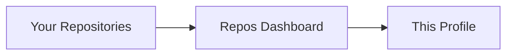

<div align="center">


[](https://git.io/typing-svg)

<a href="https://github.com/HTL2910"></a>
<a href="https://HTL2910.github.io/github-repos-dashboard/"></a>


```text
📍 GitHub User: HTL2910
```

</div>

## `> whoami`

This profile is auto-generated by the [Repos Dashboard](https://github.com/HTL2910/github-repos-dashboard). It shows an overview of repositories, categories, and activity.



## `> toolchain`

<div align="center">

### Languages & Tools


</div>

## `> github stats`

<div align="center">


</div>

## `> trophies`

<div align="center">


</div>

## `> stats`

**Total repositories**: 43  
**Last updated**: 2026-11-27

### Categories

- 🎮 Unity / Game: **19**
- 🤖 AI / ML: **13**
- 🌐 Web / Frontend: **9**
- 📁 Other: **2**

## `> recent repos`

| Repo | Language | Updated | Stars | Category |
|------|----------|---------|-------|----------|
| [social-flow-extension](https://github.com/HTL2910/social-flow-extension) | JavaScript | 2026-11-26 | 0 | 🌐 Web / Frontend |
| [shopee-category-crawler](https://github.com/HTL2910/shopee-category-crawler) | JavaScript | 2026-11-26 | 0 | 🌐 Web / Frontend |
| [page-harvest](https://github.com/HTL2910/page-harvest) | JavaScript | 2026-11-26 | 0 | 🌐 Web / Frontend |
| [OCR-Text-In-Vcam](https://github.com/HTL2910/OCR-Text-In-Vcam) | Python | 2026-11-26 | 0 | 🤖 AI / ML |
| [FPS-Zombie-Suong-Mu](https://github.com/HTL2910/FPS-Zombie-Suong-Mu) | JavaScript | 2026-11-22 | 0 | 🌐 Web / Frontend |
| [Dungeon-Survivor-3D](https://github.com/HTL2910/Dungeon-Survivor-3D) | JavaScript | 2026-11-22 | 0 | 🌐 Web / Frontend |
| [muse-3-vn-realtime-voice-agent](https://github.com/HTL2910/muse-3-vn-realtime-voice-agent) | Python | 2026-11-22 | 0 | 🤖 AI / ML |
| [muse-1-vn-address-autofill](https://github.com/HTL2910/muse-1-vn-address-autofill) | Python | 2026-11-22 | 0 | 🤖 AI / ML |
| [muse-2-multi-account-video-stats](https://github.com/HTL2910/muse-2-multi-account-video-stats) | Python | 2026-11-22 | 0 | 🤖 AI / ML |
| [laya_address_vn](https://github.com/HTL2910/laya_address_vn) | Python | 2026-11-22 | 0 | 🤖 AI / ML |
| [HTL2910](https://github.com/HTL2910/HTL2910) | - | 2026-11-10 | 0 | 📁 Other |
| [github-repos-dashboard](https://github.com/HTL2910/github-repos-dashboard) | HTML | 2026-11-10 | 1 | 🌐 Web / Frontend |

## `> contribution snake`

<div align="center">

<picture>
  <source media="(prefers-color-scheme: dark)" srcset="https://raw.githubusercontent.com/HTL2910/HTL2910/output/github-contribution-grid-snake-dark.svg">
  
</picture>

</div>

<div align="center">

[](https://github.com/HTL2910/github-repos-dashboard/actions/workflows/update-dashboard.yml)
[](https://github.com/HTL2910/github-repos-dashboard)


</div>