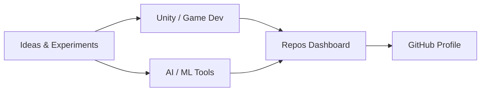

<div align="center">


[](https://git.io/typing-svg)

<a href="https://github.com/HTL2910"></a>
<a href="https://github.com/hathanhlong2002"></a>
<a href="https://HTL2910.github.io/github-repos-dashboard/"></a>


```text
📍 Vietnam  ·  🎮 Unity & Game Development  ·  🤖 AI / ML Enthusiast
```

</div>

## `> whoami`

Game Developer and AI enthusiast focused on **Unity**, **C#**, and practical AI tools. Building games, automation scripts, and dashboards that help manage and showcase projects.



## `> toolchain`

<div align="center">

### Languages & Tools


### Focus Areas


</div>

## `> github stats`

### Main Account (HTL2910)

<div align="center">


</div>

### Second Account (hathanhlong2002)

<div align="center">


</div>

## `> trophies`

<div align="center">


</div>

## `> stats`

**Total repositories (HTL2910)**: 33  
**Last updated**: 2026-11-10

### Categories

- 🎮 Unity / Game: **19**
- 🤖 AI / ML: **8**
- 🌐 Web / Frontend: **4**
- 📁 Other: **2**

## `> recent repos`

| Repo | Language | Updated | Stars | Category |
|------|----------|---------|-------|----------|
| [github-repos-dashboard](https://github.com/HTL2910/github-repos-dashboard) | HTML | 2026-11-10 | 1 | 🌐 Web / Frontend |
| [HTL2910](https://github.com/HTL2910/HTL2910) | - | 2026-11-10 | 0 | 📁 Other |
| [AWS-AI-chatbot](https://github.com/HTL2910/AWS-AI-chatbot) | TypeScript | 2026-11-04 | 0 | 🌐 Web / Frontend |
| [bang-cards-deck](https://github.com/HTL2910/bang-cards-deck) | TypeScript | 2026-11-01 | 0 | 🌐 Web / Frontend |
| [Wocel](https://github.com/HTL2910/Wocel) | C# | 2026-10-08 | 0 | 🎮 Unity / Game |
| [hypit](https://github.com/HTL2910/hypit) | - | 2026-10-05 | 0 | 🤖 AI / ML |
| [Echo-of-the-Void](https://github.com/HTL2910/Echo-of-the-Void) | C# | 2026-09-26 | 0 | 🎮 Unity / Game |
| [Full-Stack-Data-Science---Machine-Learning-BootCamp-Course](https://github.com/HTL2910/Full-Stack-Data-Science---Machine-Learning-BootCamp-Course) | Jupyter Notebook | 2026-09-25 | 0 | 🤖 AI / ML |
| [shorts](https://github.com/HTL2910/shorts) | Python | 2026-09-10 | 0 | 🤖 AI / ML |
| [Interview-Project](https://github.com/HTL2910/Interview-Project) | Python | 2026-07-30 | 0 | 🤖 AI / ML |
| [education](https://github.com/HTL2910/education) | C# | 2025-12-20 | 1 | 🎮 Unity / Game |
| [Environmental-Education](https://github.com/HTL2910/Environmental-Education) | C# | 2025-12-20 | 1 | 🎮 Unity / Game |

## `> contribution snake`

<div align="center">

<picture>
  <source media="(prefers-color-scheme: dark)" srcset="https://raw.githubusercontent.com/HTL2910/HTL2910/output/github-contribution-grid-snake-dark.svg">
  
</picture>

</div>

<div align="center">

[](https://github.com/HTL2910/github-repos-dashboard/actions/workflows/update-dashboard.yml)
[](https://github.com/HTL2910/github-repos-dashboard)


</div>